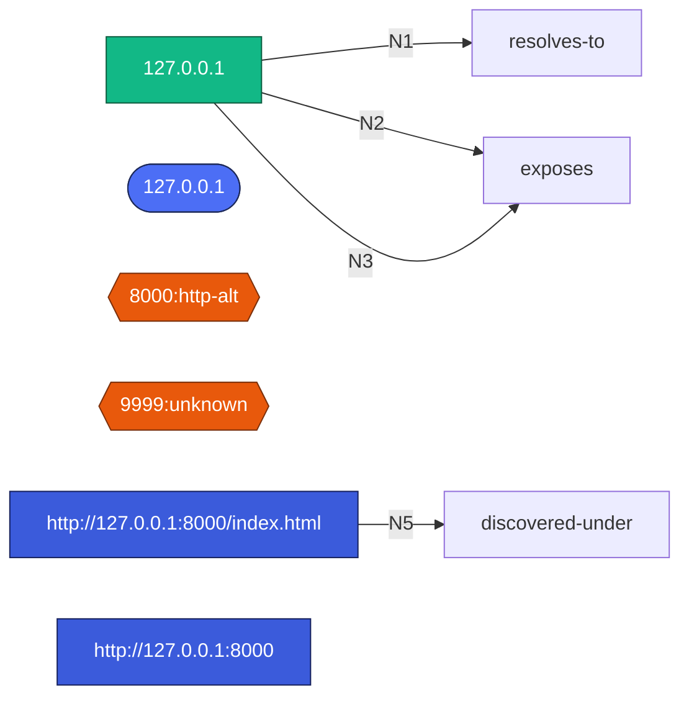

# Night Crawler — Reconnaissance Report

| | |
|---|---|
| **Target** | 127.0.0.1 |
| **Started** | 2026-10-15 10:53:52 |
| **Duration** | 139s |
| **Tool** | Night Crawler v0.1.0 |

## Executive Summary

- 3 open services with one likely exploitable version (ProFTPD 1.3.5 mod_copy).

## Attack Paths

1. FTP foothold: connect to 9999, exploit ProFTPD 1.3.5 mod_copy (SITE CPFR/CPTO) to stage a webshell.

## Target Overview

| | |
|---|---|
| Input kind | ip |
| IP | 127.0.0.1 |
| Hostname | - |
| Reverse DNS | localhost |
| Alive | true (icmp) |
| RTT | 0.0 ms |
| Inferred domain (from IP) | - |

PTR domains: localhost

## Open Ports & Services

| Port | Proto | Service | Product | Version | Banner |
|---|---|---|---|---|---|
| 8000 | tcp | http | - | - | Server: SimpleHTTP/0.6 Python/3.12.3 \| Title: NC Test Page |
| 9999 | tcp | ftp | ProFTPD | 1.3.5 | 220 ProFTPD 1.3.5 Server |

## Vulnerability Findings (fingerprint-matched)

### [HIGH] ProFTPD 1.3.5 mod_copy remote code execution (CVE-2015-3306)

- **Severity:** HIGH
- **Affected:** 127.0.0.1:9999/tcp ftp
- **Evidence:** banner: 220 ProFTPD 1.3.5 Server
- ProFTPD 1.3.5 before 1.3.5a allows unauthenticated copying of files via SITE CPFR/CPTO commands, leading to RCE.
- **Reference:** https://nvd.nist.gov/vuln/detail/CVE-2015-3306

## Subdomains (0)

_No subdomains discovered._

## HTTP Fingerprint

### http://127.0.0.1:8000

- Status: 200 | Title: NC Test Page 
- Server: SimpleHTTP/0.6 Python/3.12.3 | X-Powered-By: -
- Missing security headers: Strict-Transport-Security, Content-Security-Policy, X-Frame-Options, X-Content-Type-Options, X-XSS-Protection

## Discovered Web Paths (1)

| URL | Status | Length | Title | Note |
|---|---|---|---|---|
| http://127.0.0.1:8000/index.html | 200 | 40 | NC Test Page | found (200) |

## WHOIS

- Server: whois.iana.org
- Registrar: -
- Created: -
- Expires: -
- Organization: -
- Abuse contact: -

<details><summary>Raw WHOIS</summary>

```
--- via whois.iana.org ---
% IANA WHOIS server
% for more information on IANA, visit http://www.iana.org
% This query returned 1 object

inetnum:      127.0.0.0 - 127.255.255.255
organisation: IANA - Loopback
status:       RESERVED

remarks:      127.0.0.0/8 reserved for Loopback [RFC1122].Reserved by
remarks:      protocol. For authoritative registration,
remarks:      seeiana-ipv4-special-registry.

changed:      1981-09
source:       IANA
```
</details>

## Link Analysis (entity graph)

Graph contains **6 nodes** and **4 edges**. Top hub entities:

- **ip** `127.0.0.1` — 3 links
- **domain** `127.0.0.1` — 1 links
- **service** `8000:http-alt` — 1 links
- **service** `9999:unknown` — 1 links
- **url** `http://127.0.0.1:8000/index.html` — 1 links
- **url** `http://127.0.0.1:8000` — 1 links

### Entity Relationship Diagram (Mermaid)



## AI Decision Timeline

| Stage | Decision | Rationale |
|---|---|---|
| port-strategy | `ports=8000,9999,31337` | focused sweep of live test services |
| module-plan | `[snmp, subdirs]` | Web and legacy services detected; SNMP probe is harmless. |
| follow-up-1 | `[extend_dirs, finish]` | confirm reachable content under the web root |

## AI Planning Notes

- Model: `meta/llama-3.3-70b-instruct`
- Selected modules: snmp, subdirs
- Priorities: verify ftp banner; check web paths
- Rationale: Web and legacy services detected; SNMP probe is harmless.

## Execution Log

```
[Resolve Target] done: 127.0.0.1 -> 127.0.0.1
[Host Liveness] done: up (icmp) rtt 0.0ms
[NightCrawler Port Strategy] done: ports=8000,9999,31337
[Port Scan] done: 2 open / 3 scanned
[Service & Version Detection] done: 2 services fingerprinted
[Vulnerability Fingerprinting] done: 1 potential issues
[NightCrawler Planning] done: chose 2 modules
[DNS Recon] skipped: no domain
[Zone Transfer (AXFR)] skipped: no domain
[Subdomain Enumeration] skipped: no domain
[Web & Directory Discovery] done: 1 paths found
[SNMP Enumeration] skipped: no community accepted
[LDAP Enumeration] skipped: no LDAP service
[NetBIOS / SMB Enumeration] skipped: no SMB/NetBIOS service
[WHOIS] done: netblock org: ?
[OSINT Dorking] skipped: no domain
[NightCrawler Follow-up] done: model chose finish
[Pivot Domains] skipped: none selected by AI
[Link Analysis] done: 6 nodes / 4 edges
[NightCrawler Analysis & Report] pending
[Final Report] pending
```

## Appendix

- Full raw data: `findings.json`
- Mermaid graph: `link_analysis.mmd`
- Graph JSON: `link_analysis.json`

_Generated by Night Crawler. Use only against systems you are authorized to test._
